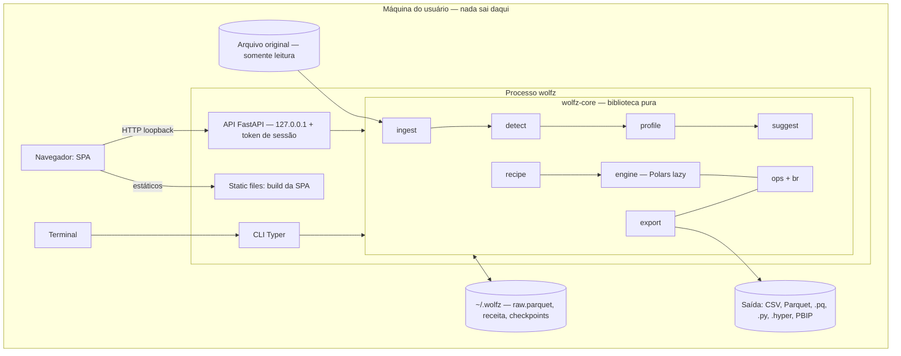

# System Design — WolfzBR

> Documento de design técnico (nível RFC interno). Escopo: aplicação local e open source para limpeza de planilhas brasileiras — núcleo Python (`wolfz-core`) com motor Polars, API FastAPI em `127.0.0.1`, SPA embutida, CLI, receitas reproduzíveis em JSON e exportação para Power Query M, script Python, `.hyper` e PBIP.
>
> **Estado:** revisado para a 1.0 (outubro de 2026). As decisões que ficaram em aberto durante o desenho estão resolvidas em §16.4, com o que foi escolhido.

---

## 1. Sumário Executivo

O problema é transformar planilhas "de relatório" — feitas para humanos lerem, com título no topo, cabeçalho em várias linhas, células mescladas, subtotais no meio dos dados e valores em formato brasileiro — em tabelas limpas e tipadas, de um jeito que possa ser **repetido no mês seguinte** e que **continue vivo dentro da ferramenta de BI**. A restrição dominante do projeto não é escala nem custo: é que **nenhum dado pode sair da máquina do usuário** (dados de clientes, LGPD). Tudo o mais — ausência de nuvem, de multiusuário, de autenticação corporativa — decorre disso.

A solução proposta é um **monolito modular local**: uma biblioteca Python pura (`wolfz-core`) que concentra toda a lógica, com duas interfaces finas por cima (API FastAPI que serve a SPA, e CLI Typer). Toda limpeza é uma **receita declarativa** — uma lista ordenada de passos de um catálogo fechado — e cada operação do catálogo tem três implementações obrigatórias: Polars (execução), Power Query M e Python (exportação). Não há banco de dados, não há fila, não há serviço externo; o estado é um diretório de trabalho em `~/.wolfz/`.

Os três trade-offs principais: (1) **expressividade sacrificada por equivalência** — o catálogo de operações é fechado, o usuário não escreve código arbitrário, e em troca toda receita é traduzível para M e Python com resultado testado como equivalente; (2) **privacidade ao custo de colaboração** — rodar 100% local elimina a superfície de vazamento de dado, mas também elimina compartilhamento em tempo real, e o único mecanismo de colaboração passa a ser versionar a receita no Git; (3) **heurística determinística em vez de modelo aprendido para detectar estrutura** — é explicável, roda offline e é testável por corpus, mas vai errar em planilhas de formato inédito, o que é mitigado tornando toda detecção um passo explícito e editável da receita, nunca um comportamento implícito.

---

## 2. Requisitos

### 2.1 Funcionais

1. Importar `.xlsx`, `.xls`, `.csv` e `.ods`, detectando encoding, separador e abas.
2. Detectar a estrutura da aba: área da tabela, linhas de cabeçalho (inclusive multinível), linhas de total/subtotal, rodapé e notas, células mescladas.
3. Exibir a pré-visualização bruta com a estrutura detectada destacada, e permitir ajuste manual da área.
4. Gerar o profiling por coluna: tipo inferido, % nulos, padrões, cardinalidade, exemplos.
5. Sugerir passos de limpeza a partir do profiling, cada um com confiança e explicação.
6. Editar a receita (aceitar/rejeitar/editar sugestões, adicionar, remover e reordenar passos) com antes/depois a cada passo.
7. Salvar e carregar a receita (`.wolfz.json`).
8. Reaplicar uma receita a uma planilha nova, pela interface ou pela CLI (`wolfz run`), falhando com mensagem clara se um `assert` não passar.
9. Exportar dados limpos (CSV, Parquet, Excel), Power Query M (`.pq`), script Python autônomo, `.hyper` + `.tds` e pasta PBIP.
10. Inspecionar uma planilha pelo terminal (`wolfz inspect`).

### 2.2 Não-funcionais

| Métrica | Valor |
|---|---|
| Usuários simultâneos | 1 (aplicação single-user, local) |
| Tamanho máximo de arquivo suportado | 100 MB (funcional, mais lento perto do teto) |
| Número máximo de linhas com experiência fluida | 500 mil linhas (o preview materializa só a página de 200 linhas) |
| Latência alvo do preview após editar um passo | p50 ≤ 300 ms, p95 ≤ 1 s (tabelas até o limite fluido) |
| Tempo alvo de importação + detecção (arquivo típico) | ≤ 1 min, dependendo do tamanho do arquivo |
| RAM mínima da máquina-alvo | 8 GB |
| Sistemas operacionais suportados | Linux e Windows (macOS não suportado oficialmente, mas pode funcionar) |
| Versão mínima do Python | 3.12 |
| Disponibilidade | não aplicável — o processo existe enquanto o usuário o mantém aberto |
| Consistência | forte, trivialmente — um único processo, um único usuário (ver §9) |
| Determinismo | mesma receita + mesmo arquivo = mesma saída, byte a byte nos dados |
| Durabilidade | o arquivo original nunca é alterado; a receita é a fonte de verdade de tudo que é derivado |
| Funcionamento offline | total — inclusive a tabela de municípios do IBGE, empacotada como Parquet |
| Distribuição geográfica | não aplicável |
| Compliance | LGPD — nenhum dado sai da máquina; sem telemetria |

### 2.3 Fora de escopo

- Hospedagem em nuvem e multiusuário.
- Publicação em Power BI Service / Tableau Cloud (exigem licença e autenticação corporativa).
- Geração de dashboards completos; o foco é o modelo de dados, visuais são bônus básico (fase 4).
- Operações livres escritas pelo usuário (código Python/M arbitrário dentro da receita).
- Edição célula a célula dos dados — toda alteração é um passo da receita.
- Conexão direta a bancos de dados ou APIs como fonte.

### 2.4 Suposições declaradas

- **SUPOSIÇÃO**: o arquivo típico é uma planilha de relatório de área de negócio, na casa de milhares a dezenas de milhares de linhas. O teto físico de uma aba `.xlsx` é 1.048.576 linhas; acima disso só CSV. O design é dimensionado para o caso típico e *não quebra* no teto, mas não promete fluidez nele (ver §8).
- **SUPOSIÇÃO**: o usuário roda o WolfzBR na própria estação de trabalho, com o arquivo em disco local ou em pasta sincronizada — não em servidor compartilhado. Isso sustenta a decisão de bind exclusivo em `127.0.0.1`.
- **SUPOSIÇÃO**: o público principal usa Windows (é onde o Power BI Desktop roda). Linux é suportado oficialmente (desenvolvimento e público de dados abertos) e entra na matriz de CI junto com o Windows (§13.1). macOS não é suportado oficialmente nem testado no CI, mas deve funcionar (§2.2).
- **SUPOSIÇÃO**: "equivalência" entre Polars e o script Python exportado é verificável automaticamente; entre Polars e M, só a sintaxe é verificável sem o Power BI Desktop. A equivalência semântica do M depende de teste manual ou CI Windows (§13.5).
- **SUPOSIÇÃO**: o repositório fica no GitHub e usa GitHub Actions como CI.

---

## 3. Estimativa de Capacidade

Não há tráfego de rede a dimensionar — o "servidor" atende um navegador na mesma máquina. O que se dimensiona aqui é o que cabe em memória e disco da estação do usuário.

### 3.1 QPS

- 1 usuário. Cada interação relevante (aceitar uma sugestão, editar um passo, rolar o grid) dispara de 1 a 3 chamadas: preview da página visível, eventualmente profiling e sugestões recalculados.
- Rolagem rápida no grid virtualizado é o único cenário que gera rajada — dezenas de pedidos de página por segundo — e é tratado no cliente com debounce e cancelamento de pedidos obsoletos (§8.8), não com capacidade de servidor.
- Fórmula geral: `QPS = interações_por_segundo × chamadas_por_interação`. Na prática, abaixo de 10 req/s sustentado.

### 3.2 Throughput leitura vs. escrita

- Leitura: preview paginado, profiling, sugestões — a esmagadora maioria das chamadas.
- Escrita: salvar a receita (um JSON de poucos KB) e exportar (batch, acionado manualmente). Importar um arquivo é a única escrita pesada: gera `raw.parquet` uma vez por projeto.

### 3.3 Storage

- Por projeto em `~/.wolfz/projects/<id>/`: `raw.parquet` (área detectada), a receita, metadados e checkpoints materializados.
- Fórmula: `tamanho_raw ≈ linhas × colunas × bytes_médios_por_célula ÷ fator_de_compressão`. Como a ingestão bruta guarda tudo como texto, estimo 10–20 bytes por célula e compressão Parquet de 3–10× em dado tabular repetitivo.
- Exemplo: 50.000 linhas × 30 colunas × 15 bytes ≈ 22 MB brutos → **~3–7 MB** em Parquet.
- No teto do `.xlsx` (1.048.576 linhas × 30 colunas): ~470 MB brutos → **~50–150 MB** em Parquet.
- Checkpoints multiplicam isso pelo número de passos materializados; por isso a política é materializar só a página exibida, não o frame inteiro de cada passo (§8.4).
- Política de limpeza do workspace: cache de checkpoints limitado a 2 GB com recolhimento LRU (§8.4). Projeto sem acesso há 90 dias é listado como "antigo", mas **nunca é apagado automaticamente**; a remoção é sempre ação do usuário.

### 3.4 Bandwidth

- Tráfego só em loopback; largura de banda não é restrição. O que importa é o custo de serializar e de o navegador processar a resposta.
- Página de preview: 200 linhas × 30 colunas × ~20 bytes em JSON ≈ **120 KB**. Aceitável em JSON; se o custo de parse virar gargalo em tabelas largas (centenas de colunas), a alternativa é Arrow IPC — não adotada de início.

### 3.5 Memória

- Polars lazy só materializa o que o plano pede. O pior caso de memória não é o preview, é a **importação** (ler a aba inteira para detectar estrutura) e a **exportação** (materializar o resultado completo).
- A leitura estrutural com `openpyxl` (mesclagens, negrito) é a parte mais cara: carrega objetos Python por célula. Mitigação: usar `openpyxl` só para os metadados estruturais e `fastexcel`/`calamine` para os valores.
- Orçamento de memória do processo: **≤ 2 GB para um arquivo de 100 MB**. É o valor verificado pelo teste de carga.

### 3.6 Instâncias

- **1 processo** por usuário. Sem workers adicionais: o paralelismo vem do próprio Polars (threads nativas), não de múltiplos processos Python.

### Tabela resumo

| Métrica | Valor estimado |
|---|---|
| QPS sustentado | < 10 req/s (1 usuário) |
| Payload de uma página de preview | ~120 KB (200 × 30) |
| `raw.parquet` de arquivo típico (50 mil × 30) | ~3–7 MB |
| `raw.parquet` no teto do `.xlsx` | ~50–150 MB |
| Memória de pico | dominada por importação e exportação, não pelo preview |
| Instâncias | 1 processo local |

---

## 4. Modelo de Domínio e Dados

### 4.1 Entidades e relacionamentos

```
Projeto (1) ──── (1) Fonte        arquivo original + aba + área detectada
Projeto (1) ──── (1) Receita
Receita (1) ──< (N) Passo         ordenado; cada passo é uma operação do catálogo
Passo   (1) ──── (0..1) Checkpoint  cache derivado, descartável
Projeto (1) ──< (N) Exportação    artefatos gerados, descartáveis
```

Só duas coisas são fonte de verdade: o **arquivo original** (nunca alterado) e a **receita**. Todo o resto — `raw.parquet`, profiling, checkpoints, exportações — é derivado e pode ser apagado e reconstruído.

### 4.2 Esquema

Não há banco relacional; o esquema é o layout do workspace e os modelos Pydantic.

```
~/.wolfz/                    # ou a pasta de WOLFZ_HOME
├── projects/<id>/
│   ├── project.json          # metadados: nome, caminho e hash do arquivo original, aba, formato
│   ├── raw.parquet           # a aba inteira (ou o CSV), tudo como texto, na posição original
│   ├── structure.json        # metadados estruturais: mesclagens, negrito, fórmulas, tipos
│   ├── detection.json        # a estrutura detectada (área, cabeçalho, totais; várias tabelas)
│   ├── recipe.wolfz.json     # a receita
│   ├── suggestions.json      # sugestões rejeitadas neste projeto
│   ├── checkpoints/          # cache por passo
│   ├── exports/              # saída padrão da exportação
│   ├── .lock                 # lock do sistema operacional: projeto aberto numa instância
│   └── .lock.json            # porta e pid de quem abriu, só para a mensagem do 423
└── uploads/                  # arquivo enviado pela interface, apagado depois da importação
```

```python
class Source(BaseModel):
    type: Literal["excel", "csv", "ods"]
    sheet: str | None = None
    match: SourceMatch | None = None      # ex.: sheet_name_regex, para a reaplicação

class Recipe(BaseModel):
    wolfz_version: str
    name: str
    created_at: datetime
    source: Source
    steps: list[Step]                     # união discriminada pelo campo `op`

class Op(BaseModel):                      # base de toda operação do catálogo
    id: str
    op: str

    def to_polars(self, lf: pl.LazyFrame) -> pl.LazyFrame: ...
    def to_m(self, prev: str, name: str) -> str: ...
    def to_python(self) -> str: ...
```

`Step` é uma união discriminada de todas as operações registradas. Uma receita com `op` desconhecida falha na validação, antes de qualquer execução.

### 4.3 Estratégia de ID

- **Passos**: sequencial curto e legível (`s1`, `s2`, …), único dentro da receita. O `id` aparece como comentário no M exportado, então legibilidade importa mais que unicidade global. O `id` não é reaproveitado quando um passo é removido, para que a referência em um M já exportado não passe a apontar para outro passo.
- **Projetos**: **ULID**. Ordena por data de criação e é seguro como nome de pasta. (Alternativas descartadas: UUID, que não ordena, e slug do nome do arquivo, que colide.)
  - **Formato**: 26 caracteres em Crockford Base32, sempre em maiúsculas (ex.: `01JA8Z3K6QF4V7XG2M9T5RNB0C`). Sem `/`, `\`, `.` ou espaço, e sem diferença de caixa entre IDs, então funciona igual em sistemas de arquivos que diferenciam maiúsculas (Linux) e nos que não diferenciam (Windows).
  - **Geração**: pacote `python-ulid`, no momento do `POST /projects`. Não precisa de monotonicidade dentro do mesmo milissegundo: há um único usuário.
  - **Onde aparece**: nome da pasta (`~/.wolfz/projects/<id>/`), parâmetro de rota da API (`/projects/{id}`) e campo `project_id` dos logs (§12.1). Na interface, o projeto é mostrado pelo nome, nunca pelo ID.
  - **Fora da receita**: o ID não entra no `recipe.wolfz.json`. Como o ULID carrega um timestamp, deixá-lo fora mantém a receita determinística e portável entre máquinas (§9).
  - **Validação**: a API só aceita IDs que casam com `^[0-9A-HJKMNP-TV-Z]{26}$` antes de montar qualquer caminho. Isso fecha path traversal (`../`) pelo parâmetro de rota (§11.4).
  - **Nome legível**: o nome do arquivo original fica no `project.json` (campo `name`) e pode ser renomeado sem mexer no ID nem na pasta.

### 4.4 Chaves de cache e o que servem

| Chave | Serve a |
|---|---|
| hash do arquivo original + aba + área | reaproveitar `raw.parquet` quando o mesmo arquivo é reaberto |
| hash de `raw` + passos `s1..sN` serializados | checkpoint do passo N |
| hash de `raw` + passos `s1..sN` | profiling da tabela após o passo N |

A chave do checkpoint N depende de todos os passos até N. Editar o passo N muda a chave de N em diante e não toca nas anteriores — é isso que implementa "editar o passo N invalida os checkpoints de N em diante" sem lógica de invalidação explícita.

### 4.5 Access patterns que motivaram a modelagem

- O grid sempre pede "página P da tabela após o passo N" → o estado é endereçado por (projeto, passo, intervalo de linhas), nunca pela tabela inteira.
- A edição quase sempre é no fim da receita (adicionar o próximo passo) → os checkpoints anteriores continuam válidos e o custo é incremental.
- A reaplicação (`wolfz run`) não usa cache nenhum: lê o arquivo novo e executa a receita inteira de uma vez, em um único plano lazy.

### 4.6 O que fica desnormalizado e por quê

- `raw.parquet` duplica o conteúdo do arquivo original, de propósito: ler Parquet é ordens de grandeza mais rápido que reabrir o `.xlsx` a cada preview.
- A receita referencia colunas por **nome**, nunca por índice, mesmo que isso repita strings em vários passos — é o que permite a receita sobreviver a colunas novas na planilha do mês seguinte.
- Profiling é recalculado e guardado por passo em vez de derivado incrementalmente: mais simples e sempre correto.

---

## 5. Contrato da API

### 5.1 Estilo

**REST sobre HTTP em loopback**, não GraphQL nem gRPC. O único consumidor é a SPA embutida no mesmo pacote; REST + OpenAPI gerado pelo FastAPI dá tipagem do cliente de graça e é o que tem menor atrito para quem for contribuir. A API não é um produto: quem quer integração programática usa a biblioteca (`import wolfz`) ou a CLI.

### 5.2 Convenções

- Tudo sob o prefixo `/api`, para separar das rotas estáticas da SPA.
- Recursos no plural (`/projects`).
- Verbos: `GET` para leitura, `POST` para criar projeto e disparar exportação, `PUT` para substituir a receita inteira, `DELETE` para remover projeto.
- Status codes: `200`/`201` sucesso, `401` token de sessão ausente ou inválido, `404` projeto ou passo inexistente, `409` receita desatualizada (§9), `423` projeto aberto em outra instância (§9), `413` arquivo acima do limite, `422` erro de validação — inclusive receita inválida e `assert` reprovado, `500` erro não tratado.

### 5.3 Especificação OpenAPI 3.1 (endpoints principais)

```yaml
openapi: 3.1.0
info:
  title: WolfzBR Local API
  version: "1.0"
paths:
  /api/projects:
    post:
      summary: Cria um projeto a partir de um arquivo
      requestBody:
        content:
          multipart/form-data:
            schema:
              type: object
              properties:
                file: { type: string, format: binary }
                sheet: { type: string }
      responses:
        "201":
          description: Projeto criado, com estrutura detectada e receita inicial
          content:
            application/json:
              schema: { $ref: "#/components/schemas/Project" }
        "413": { $ref: "#/components/responses/Problem" }
        "422": { $ref: "#/components/responses/Problem" }

  /api/projects/{id}/preview:
    get:
      summary: Página de linhas da tabela após um passo da receita
      parameters:
        - { name: id, in: path, required: true, schema: { type: string } }
        - name: step
          in: query
          description: id do passo; omitido = receita inteira; "raw" = antes de qualquer passo
          schema: { type: string }
        - { name: offset, in: query, schema: { type: integer, default: 0, minimum: 0 } }
        - { name: limit, in: query, schema: { type: integer, default: 200, maximum: 1000 } }
      responses:
        "200":
          description: Linhas, esquema e contagem total
          content:
            application/json:
              schema:
                type: object
                properties:
                  columns:
                    type: array
                    items:
                      type: object
                      properties:
                        name: { type: string }
                        dtype: { type: string }
                  rows: { type: array, items: { type: array } }
                  total_rows: { type: integer }
        "404": { $ref: "#/components/responses/Problem" }
        "422": { $ref: "#/components/responses/Problem" }

  /api/projects/{id}/recipe:
    get:
      summary: Receita atual do projeto
      responses:
        "200":
          content:
            application/json:
              schema: { $ref: "#/components/schemas/Recipe" }
    put:
      summary: Substitui a receita inteira
      parameters:
        - { name: If-Match, in: header, required: true, schema: { type: string } }
      requestBody:
        content:
          application/json:
            schema: { $ref: "#/components/schemas/Recipe" }
      responses:
        "200": { description: Receita salva; devolve a nova ETag }
        "409": { $ref: "#/components/responses/Problem" }
        "422": { $ref: "#/components/responses/Problem" }

  /api/projects/{id}/exports:
    post:
      summary: Gera artefatos de exportação
      requestBody:
        content:
          application/json:
            schema:
              type: object
              properties:
                formats:
                  type: array
                  items:
                    type: string
                    enum: [csv, parquet, xlsx, powerquery, python, hyper, pbip]
                output_dir: { type: string }
      responses:
        "200": { description: Lista dos arquivos gerados }
        "422": { $ref: "#/components/responses/Problem" }

components:
  responses:
    Problem:
      description: Erro no formato Problem Details
      content:
        application/problem+json:
          schema: { $ref: "#/components/schemas/ProblemDetails" }
```

*(Os demais seguem o mesmo padrão: `GET /api/projects`, `GET` e `DELETE /api/projects/{id}`, `GET /api/projects/{id}/structure` e `/profile`, `GET /api/projects/{id}/suggestions` e `POST .../suggestions/rejections`, `GET /api/projects/{id}/steps/{step}/municipios` e `GET /api/municipios` para a revisão de municípios, `POST /api/sheets` para listar as abas antes de importar, `GET /api/export-formats` e `GET /api/ops` com o catálogo e os schemas das operações. O contrato completo é o OpenAPI gerado pelo FastAPI, versionado em `frontend/src/api/openapi.json`; um teste falha se ele divergir da API.)*

### 5.4 Formato de erro padronizado

**RFC 9457 (Problem Details)**, estendido com o passo que falhou — o erro mais comum do sistema é "o passo N não se aplica a esta planilha", e a interface precisa saber qual passo destacar:

```json
{
  "type": "about:blank",
  "title": "Coluna não encontrada",
  "status": 422,
  "detail": "O passo s5 (parse_brl) referencia a coluna 'valor_bruto', que não existe após o passo s4.",
  "instance": "/api/projects/abc/preview",
  "step_id": "s5",
  "available_columns": ["filial", "regiao", "valor"]
}
```

A mesma estrutura alimenta a mensagem de erro da CLI, para que `wolfz run` e a interface falhem com o mesmo texto.

### 5.5 Paginação

**Offset/limit**, não cursor. O grid virtualizado precisa de acesso aleatório ("me dê as linhas 40.000 a 40.200" quando o usuário arrasta a barra de rolagem), que cursor não oferece. O defeito clássico do offset — resultado instável quando o dado muda entre páginas — não existe aqui: a tabela de um dado passo é imutável enquanto a receita não muda, e quando muda o cliente recarrega tudo.

### 5.6 Filtros, ordenação, sparse fieldsets

- Filtros e ordenação **não são parâmetros do preview**: se o usuário quer filtrar ou ordenar, isso é um passo da receita (`filter`, `sort`). Manter o preview como espelho fiel da receita evita o usuário ver uma coisa na tela e exportar outra.
- Filtro/ordenação apenas de visualização, que não entram na receita: **fora do MVP**. Entra depois da 1.0 se houver pedido.
- Sparse fieldsets: parâmetro `columns` opcional no preview, para tabelas muito largas em que o grid só exibe as colunas visíveis.

### 5.7 Versionamento

- **API**: sem versionamento de URL. A SPA é compilada e distribuída no mesmo pacote que o backend, então cliente e servidor nunca estão em versões diferentes.
- **Receita**: é o contrato de verdade, e é versionada pelo campo `wolfz_version`. Receitas antigas são migradas por `recipe/migrate.py` ao carregar. Receita de versão *mais nova* que o WolfzBR instalado é recusada com mensagem pedindo atualização, nunca interpretada parcialmente.
- Política de compatibilidade da receita: toda receita `1.x` abre em qualquer versão `1.y`. Receitas `0.x` têm migração até a 1.0 e depois deixam de abrir.
- **Python**: a API pública é o que está em `wolfz.__all__` (`run`, `load_recipe`, `RecipeError`, `StepError`, `br`) e em `wolfz.br.__all__` (as funções de valor), e segue o versionamento semântico do pacote. `wolfz.core`, `wolfz.ops`, `wolfz.export`, `wolfz.api`, `wolfz.cli` e os submódulos de `wolfz.br` são internos e mudam sem aviso; o contrato das operações é o nome e os parâmetros na receita, não as classes Python.

### 5.8 Idempotência

- `PUT /recipe` é idempotente por definição (substitui o documento inteiro).
- `POST /projects` cria um projeto novo a cada chamada; reimportar o mesmo arquivo reaproveita o `raw.parquet` pela chave de hash (§4.4), então a repetição é barata.
- `POST /exports` sobre um diretório que já contém arquivos: **falha por padrão**. Sobrescrever exige `--overwrite` na CLI ou confirmação explícita na interface.

### 5.9 Rate limiting

Não aplicável — um usuário, na própria máquina. A proteção contra acesso indevido é o token de sessão e o bind em loopback (§11.1), não limite de taxa.

### 5.10 Long-running operations

Importação de arquivo grande e exportação podem levar de segundos a minutos. No MVP ficam **síncronas**, com a interface mostrando estado de carregamento. Se o tempo observado no corpus passar do tolerável, a evolução é `202 Accepted` + endpoint de status com progresso — o processamento já roda fora do event loop (threadpool), então a mudança é de contrato, não de arquitetura.

### 5.11 Bulk operations

- Na API: não há. Uma receita, um arquivo.
- Na CLI: aplicar a mesma receita a vários arquivos de uma vez (`wolfz run receita.wolfz.json pasta/*.xlsx`): **entra na Fase 2**. É barato e muito útil para quem recebe 12 arquivos mensais.
  - **Entrada**: um ou mais caminhos ou padrões glob depois da receita. O próprio WolfzBR expande o glob, porque o PowerShell e o `cmd` do Windows não expandem `*.xlsx` como o shell do Linux. Os arquivos são processados em **ordem alfabética**, para que o resultado e o relatório sejam determinísticos.
  - **Execução**: **sequencial**, um arquivo por vez. O paralelismo continua vindo do Polars dentro de cada arquivo; rodar vários em paralelo estouraria o orçamento de memória (§3.5).
  - **Saída**: `-o saida/` vira a pasta-raiz, com um resultado por arquivo de entrada nomeado a partir do arquivo original (`saida/vendas_jan.csv`, `saida/vendas_fev.csv`…). Se dois arquivos gerariam o mesmo nome, o lote falha **antes de começar**. A regra de diretório existente vale para o lote inteiro (§5.8): sem `--overwrite`, falha se `saida/` já tiver arquivos.
  - **Falha em um arquivo**: cada arquivo é independente e atômico (build-then-swap, §9). Por padrão o lote **continua** nos demais e reporta tudo no fim; `--fail-fast` interrompe no primeiro erro.
  - **Relatório**: tabela no terminal (arquivo, status, linhas de saída, tempo, motivo da falha) e `saida/_relatorio.json` com o mesmo conteúdo, para quem automatiza. O motivo usa o formato de erro padronizado (§5.4).
  - **Código de saída**: `0` se todos passaram, `1` se pelo menos um falhou, `2` para erro de uso (receita inválida, nenhum arquivo encontrado, colisão de nomes). Permite usar o `wolfz run` em scripts e agendadores.

---

## 6. Arquitetura de Alto Nível

Diagrama estático: [arquitetura.png](arquitetura.png).

### 6.1 Fluxo request → response (Mermaid)



### 6.2 Componentes e fronteira de responsabilidade

| Componente | Responsabilidade | NÃO faz |
|---|---|---|
| `ingest` | Abrir o arquivo, detectar encoding/separador, listar abas, produzir a matriz de células (valor, tipo, mesclagem, negrito) | Não interpreta o que é cabeçalho ou total |
| `detect` | Pontuar linhas e propor área, cabeçalho, totais, rodapé — como **passos de receita** | Não aplica nada; só propõe |
| `profile` | Tipo inferido, nulos, padrões, cardinalidade por coluna | Não sugere ação |
| `suggest` | Regras heurísticas sobre o perfil → passos sugeridos com confiança e motivo | Não altera a receita sem aceite |
| `recipe` | Modelo, validação, migração de versão, serialização estável | Não executa |
| `ops` + `br` | Catálogo de operações (schema + Polars + M + Python) e parsers/validadores brasileiros | Não conhece API nem arquivos |
| `engine` | Compor os passos em um plano lazy, materializar páginas, gerenciar checkpoints | Não conhece formato de exportação |
| `export` | Traduzir receita e dados para os formatos de saída | Não reimplementa operações — delega a `to_m`/`to_python` de cada op |
| API | Transporte, token de sessão, serialização, servir a SPA | Nenhuma regra de negócio |
| CLI | Argumentos, saída no terminal, códigos de retorno | Nenhuma regra de negócio |

### 6.3 Estilo arquitetural

**Monolito modular, com o núcleo como biblioteca pura.**

Por que não separar em serviços: há um processo, um usuário e uma máquina. Qualquer fronteira de rede interna seria latência e complexidade de empacotamento sem nenhum ganho.

A fronteira que importa é a de **dependência**, não de deploy: `core`, `ops`, `br` e `export` não importam nada de `api` nem de `cli`. Isso é o que permite testar tudo sem subir servidor, usar o WolfzBR em notebook e trocar o frontend sem tocar na lógica. A regra é verificável por lint de imports no CI.

### 6.4 Síncrono vs. assíncrono

Request-response síncrono do ponto de vista do cliente. Internamente, os handlers que tocam o motor rodam em threadpool: Polars libera o GIL durante a execução, e um preview pesado não pode travar o event loop que atende o pedido seguinte. Não há fila nem worker separado — não há trabalho que precise sobreviver ao processo.

### 6.5 Fluxo detalhado dos 2 casos de uso mais críticos

**Caso 1 — importar e detectar (`POST /api/projects`):**
1. Upload chega; a API valida o token e o tamanho.
2. `ingest` identifica o tipo pelo conteúdo, não só pela extensão; para CSV, detecta encoding e separador.
3. Valores são lidos com `fastexcel`/`calamine`; metadados estruturais (mesclagens, negrito) com `openpyxl`.
4. `detect` pontua cada linha, localiza a região de dados, o cabeçalho, os totais e o rodapé.
5. A detecção é convertida em passos explícitos (`select_range`, `header_rows`, `drop_rows_where`, `fill_down`) que formam a receita inicial.
6. A área detectada é gravada como `raw.parquet`; notas de rodapé vão para os metadados.
7. Resposta: projeto, estrutura detectada (para o destaque visual) e receita inicial.

**Caso 2 — editar um passo e ver o antes/depois (`PUT /recipe` → `GET /preview`):**
1. A SPA envia a receita inteira com `If-Match`.
2. `recipe` valida contra os schemas do catálogo; receita inválida devolve `422` apontando o passo e o campo.
3. A receita é gravada de forma atômica (§9). Nenhum checkpoint é apagado: as chaves dos passos alterados simplesmente mudam.
4. A SPA pede o preview do passo anterior e do passo editado, para a página visível.
5. `engine` parte do checkpoint mais próximo ainda válido, compõe os passos seguintes em um plano lazy e materializa só `offset..offset+limit`.
6. Se um passo falha (coluna inexistente, tipo incompatível), a resposta é um Problem Details com o `step_id`; os passos anteriores continuam exibíveis.

**Reaplicação (`wolfz run`)** percorre o mesmo núcleo sem API e sem cache: lê o arquivo novo, resolve a aba por `source.match`, executa a receita inteira e os `assert`, e só grava a saída se tudo passar.

---

## 7. Escolhas de Tecnologia

| Camada | Escolha | Alternativas | Por que essa | Custo do trade-off |
|---|---|---|---|---|
| Motor | Polars (lazy) | pandas, DuckDB como motor | API declarativa mapeia 1:1 para passos de receita; lazy permite materializar só a página; tipagem estrita expõe erro cedo | Menos familiar que pandas para contribuidores; o script exportado depende de Polars |
| Leitura Excel (valores) | `fastexcel` / `python-calamine` | `openpyxl`, `pandas.read_excel` | Muito mais rápido; lê `.xls` binário e `.ods` | Não expõe formatação nem mesclagem |
| Leitura Excel (estrutura) | `openpyxl` | `calamine` apenas | Único que entrega células mescladas e negrito, que são sinais da detecção | Lento e pesado em memória; não lê `.xls` — nesses arquivos a detecção perde os sinais de formatação |
| CSV / encoding | Ordem fixa (BOM → UTF-8 válido → cp1252 → latin-1) + `csv.Sniffer` | `charset-normalizer`, `chardet` | Determinística e certa para dado brasileiro: a detecção estatística escolhia cp1250 no CSV do CEIS e corrompia todo acento | Arquivo em outra página de código (raro no Brasil) sai com acento errado; `fix_mojibake` conserta o caso comum |
| Modelo da receita | Pydantic v2 | dataclasses + jsonschema | União discriminada por `op`, JSON Schema gerado para a interface montar formulários | Acopla o formato da receita ao Pydantic |
| API | FastAPI + Uvicorn | Flask, Litestar | OpenAPI automático, integração nativa com Pydantic | Nenhum relevante nesta escala |
| CLI | Typer | Click, argparse | Mesma base de type hints do resto do código | Dependência a mais |
| Frontend | React + Vite (TypeScript) | Svelte, HTML e CSS sem framework | Ecossistema maior para grid, testes (Playwright) e contribuição; o build é estático e vai dentro do pacote Python | Bundle maior que Svelte; Node só para quem desenvolve, nunca para quem usa |
| Grid | Glide Data Grid | AG Grid Community | Desenha em canvas: rolagem fluida em centenas de milhares de linhas, pedindo as páginas sob demanda | Sacrifica a flexibilidade e a composição do DOM (célula customizada, seleção de texto, acessibilidade nativa) |
| Fuzzy match | `rapidfuzz` | `thefuzz`, Levenshtein próprio | Rápido, licença permissiva | Não existe em M — exige a estratégia de de-para (ADR-7) |
| SQL ad hoc | DuckDB (extra `wolfzbr[sql]`, pós-1.0) | nenhum | Consultar o Parquet de cache sem código | Mais uma dependência pesada; por isso opcional. Na 1.0 o extra existe, mas nenhum código o usa |
| Tableau | `tableauhyperapi` (extra opcional) | `pantab` | API oficial, tipos corretos | Binário grande e licença proprietária; fica em `wolfzbr[tableau]` |
| Power BI | Geração de texto (TMDL + PBIR JSON) | Tabular Object Model via .NET | PBIP é baseado em arquivos; não exige Windows nem .NET para gerar | Formato pode mudar; templates isolados em `export/pbip/` |
| Empacotamento | `pipx install wolfzbr` (fase 1) | PyInstaller, Tauri + sidecar (fase 4) | Zero trabalho de empacotamento para early adopters | Exige Python instalado — barreira para o usuário não técnico |
| Banco | Nenhum — arquivos em `~/.wolfz/` | SQLite | Dois tipos de dado (Parquet e JSON), um usuário, nenhuma consulta relacional | Listar projetos é varrer diretórios; aceitável até centenas de projetos |

---

## 8. Escalabilidade

### 8.1 Vertical vs. horizontal

Só existe vertical, e ela é a máquina do usuário. Horizontal não se aplica. "Escalar" aqui significa aguentar arquivos maiores na mesma máquina, e isso se resolve com lazy + streaming, não com mais hardware.

### 8.2 Estado

O processo guarda em memória apenas o token de sessão e caches descartáveis. Todo estado durável está em disco, em `~/.wolfz/`. Matar o processo e reabrir não perde nada além do que não foi salvo na receita.

### 8.3 Load balancing

Não aplicável.

### 8.4 Estratégia de cache

- Cache = checkpoints por passo, endereçados por hash de conteúdo (§4.4). Não há TTL nem invalidação explícita: chave que não é mais referenciada vira lixo e é recolhida.
- **O que materializar**: só a página pedida. Materializar o frame inteiro de cada passo multiplicaria o uso de disco pelo número de passos (§3.3).
- Exceção: passos que não são expressáveis como plano lazy barato — `unpivot`, `pivot`, `dedupe`, `sort`, e o `normalize_municipio` com fuzzy — podem justificar checkpoint completo, porque recalculá-los a cada rolagem do grid é caro.
- Limite de tamanho do cache e política de recolhimento: **≤ 2 GB, recolhimento LRU**. Só checkpoints são recolhidos; `raw.parquet` e receita de um projeto existente nunca são.

### 8.5 Réplicas de leitura / replication lag

Não aplicável.

### 8.6 Particionamento/sharding

Não aplicável. Arquivos são processados inteiros.

### 8.7 Connection pooling

Não aplicável — não há banco em rede. O DuckDB opcional é embarcado e abre o Parquet sob demanda.

### 8.8 Backpressure

- No cliente: debounce da rolagem e cancelamento de pedidos de preview que ficaram obsoletos — só a última página pedida importa.
- No servidor: um preview por projeto por vez; pedido novo para o mesmo projeto substitui o anterior na fila.
- Arquivo acima do limite suportado (§2.2) é recusado na importação com `413` e mensagem clara, em vez de degradar até travar a máquina.

---

## 9. Consistência e Coordenação

- **Consistência forte, trivialmente**: um processo, um usuário, um disco. Toda leitura reflete a receita gravada.
- **Gravação atômica da receita**: escrever em arquivo temporário no mesmo diretório e renomear por cima. Um crash no meio deixa a receita antiga intacta, nunca um JSON truncado.
- **Concorrência**: o único cenário real é o mesmo projeto aberto em duas abas do navegador. Tratado com concorrência otimista — `ETag` na leitura, `If-Match` na escrita, `409` se a receita mudou por baixo. Lock pessimista seria desproporcional.
- **Duas instâncias do WolfzBR sobre o mesmo workspace**: permitidas, com **lockfile por projeto** (não pelo workspace inteiro). A segunda instância que tentar abrir um projeto já aberto recebe erro claro; projetos diferentes podem ser editados em paralelo.
  - **Arquivo**: `~/.wolfz/projects/<id>/.lock`, com lock de arquivo do sistema operacional via pacote `filelock` (funciona igual em Windows e Linux). O lock é do SO, não só a existência do arquivo: se o processo morrer ou travar, o SO libera sozinho e não sobra lock órfão para limpar à mão.
  - **Quando é adquirido**: ao abrir o projeto na interface (`GET /projects/{id}`) ou ao criá-lo. É mantido enquanto o projeto estiver aberto e liberado ao fechar o projeto ou encerrar o processo.
  - **Metadados para a mensagem**: ao lado do lock, `.lock.json` com `pid`, porta da instância e `opened_at`. Serve só para a mensagem de erro ("este projeto já está aberto em outra janela do WolfzBR, em http://127.0.0.1:PORTA"), nunca para decidir se o lock é válido.
  - **Erro na API**: `423 Locked` no formato padrão (§5.4), separado do `409` do `ETag`, para a interface mostrar "aberto em outra instância" em vez de "receita desatualizada". O projeto aparece na listagem como "aberto em outra instância", sem permitir edição.
  - **O que não precisa de lock**: `wolfz run` (não usa o workspace, §4.5), `wolfz inspect` e a listagem de projetos. Duas abas da mesma instância continuam tratadas pelo `ETag`, porque o lock é por processo.
  - **Limpeza do cache** (§3.3, §8.4): o recolhimento LRU pula projetos com lock ativo.
  - **Limitação**: workspace em pasta de rede ou sincronizada (OneDrive, Google Drive) pode não respeitar lock de arquivo. Não é suportado; o padrão `~/.wolfz/` fica no disco local.
- **Transações**: exportação é build-then-swap — gera tudo em diretório temporário e move no fim, para nunca deixar uma pasta PBIP pela metade que o Power BI abriria com erro.
- **Determinismo**: nenhuma operação depende de relógio, locale da máquina, ordem de dicionário ou aleatoriedade. Parsers BR usam regras fixas, não o locale do sistema. É pré-requisito para os testes de snapshot e para a promessa de reprodutibilidade.
- **Exactly-once / at-least-once, sagas, ordenação de eventos**: não aplicável — não há mensagens nem serviços.

---

## 10. Confiabilidade e Resiliência

### 10.1 Modos de falha por dependência

| Dependência | O que acontece se falhar | Impacto |
|---|---|---|
| Arquivo corrompido ou protegido por senha | Erro na importação, com a causa nomeada | Nenhum projeto é criado; nada a limpar |
| Arquivo aberto no Excel (lock no Windows) | Leitura pode falhar com erro de permissão | Mensagem específica pedindo para fechar o arquivo, em vez de stack trace |
| Encoding detectado errado em CSV | Texto com caracteres trocados no preview | Visível de imediato; usuário corrige o encoding manualmente e reimporta |
| Detecção de estrutura errada | Receita inicial incorreta | Baixo — todo passo detectado é editável; é o caso previsto, não uma falha |
| Memória insuficiente em arquivo grande | Processo morre | Total para a sessão; mitigado pelo limite de tamanho na importação (§8.8) |
| Disco cheio no workspace | Falha ao gravar `raw.parquet` ou checkpoint | Importação falha limpa; a receita, por ser gravada atomicamente, não corrompe |
| `tableauhyperapi` não instalado | Export `.hyper` indisponível | Só esse formato; ver §10.5 |
| Planilha nova com formato diferente na reaplicação | `assert` reprova ou coluna não é encontrada | Execução falha sem gravar saída — é o comportamento desejado |
| Mudança no formato PBIP/TMDL | PBIP gerado não abre no Desktop novo | Só esse formato; templates isolados facilitam a correção |

### 10.2 Timeouts

Não há dependência de rede no caminho de execução, então não há orçamento de latência a dividir. O único timeout útil é o de cancelamento pelo usuário: operações longas (importação, exportação) precisam poder ser interrompidas pela interface sem matar o processo.

### 10.3 Retries

Não aplicável no núcleo — todas as operações são determinísticas; tentar de novo dá o mesmo resultado. A exceção é a leitura de arquivo com lock transitório (pasta sincronizada por OneDrive/Drive no meio de uma sincronização), onde uma nova tentativa curta é razoável.

### 10.4 Circuit breaker / bulkheads

Não aplicável — sem dependências externas síncronas.

### 10.5 Graceful degradation

- Sem `tableauhyperapi`: a opção `.hyper` aparece desabilitada com a instrução de instalação (`pip install wolfzbr[tableau]`); os demais formatos funcionam.
- `openpyxl` falha em ler a estrutura (arquivo exótico, ou `.xls` que ele não suporta): a detecção segue só com os sinais de valor (densidade, tipos, palavras-chave de total), sem mesclagem e negrito, e a interface avisa que a detecção está com menos informação.
- Uma regra de sugestão lança exceção: é registrada em log e ignorada; as outras regras continuam. Sugestão é bônus, não pode derrubar o fluxo.
- Um passo da receita falha: os passos anteriores continuam visualizáveis; só o passo com erro e os seguintes ficam marcados.

### 10.6 Dead letter queue / reprocessamento

Não aplicável — sem fila.

### 10.7 Backup, restore, RPO/RTO reais

- **Backup**: o arquivo original nunca é modificado e a receita é um JSON de chaves ordenadas feito para o Git. Com os dois, tudo é reconstruível.
- **RPO**: a última gravação da receita. Com salvamento automático a cada alteração (decidido: automático, com gravação atômica e `ETag` contra duas abas editando ao mesmo tempo), é efetivamente zero.
- **RTO**: o tempo de reimportar o arquivo e reexecutar a receita — segundos a minutos.
- Apagar `~/.wolfz/` inteiro não perde nada que o usuário não possa refazer, desde que a receita tenha sido salva fora do workspace ou versionada.

### 10.8 Multi-AZ / multi-região

Não aplicável.

---

## 11. Segurança

O modelo de ameaça não é um atacante na internet: é **outro software na mesma máquina** — em particular, uma página web maliciosa aberta em outra aba, tentando falar com a API local para ler dados de cliente.

### 11.1 AuthN

- O servidor escuta **apenas em `127.0.0.1`**, nunca em `0.0.0.0`, em porta livre aleatória.
- Um **token de sessão** aleatório é gerado a cada start e entregue à SPA na URL que o `wolfz ui` abre. Toda chamada a `/api` exige o token.
- O token vai no header `Authorization: Bearer` de cada chamada. Na URL de abertura ele vem no fragmento (`#token=…`), que o navegador não envia ao servidor e não aparece em log de acesso; a SPA o guarda só na memória da página, sem `localStorage` nem cookie.

### 11.2 Token

Opaco, de alta entropia (`secrets.token_urlsafe`), válido só enquanto o processo vive, nunca gravado em disco nem em log. Não é JWT: não há o que codificar nele nem quem mais precise validá-lo.

### 11.3 AuthZ

Não aplicável — um usuário, dono de todos os projetos. A fronteira de autorização é a do sistema operacional: o workspace herda as permissões da pasta do usuário.

### 11.4 Validação de input e limites

- **Validação do header `Host`**: aceitar só `127.0.0.1:<porta>` e `localhost:<porta>`. É a defesa contra DNS rebinding, em que um domínio externo passa a resolver para o loopback.
- **CORS**: nenhuma origem externa permitida. A SPA é servida pela mesma origem; em desenvolvimento, só a origem do Vite.
- **Upload**: limite de tamanho (§2.2). `.xlsx` e `.ods` são arquivos zip — limitar também o tamanho *descompactado*, contra zip bomb.
- **Regex fornecida pelo usuário** (`assert` com `matches`): executada pelo motor de regex do Polars (crate `regex` do Rust), que garante tempo linear e não tem backtracking catastrófico. O `re` do Python só compila o padrão para validar a receita e casa o nome da aba (`source.match.sheet_name_regex`), que tem no máximo 31 caracteres; nunca roda sobre os dados. `drop_rows_where`, `filter` e `replace` comparam texto literal.
- **Caminhos**: nomes de arquivo e `output_dir` são normalizados e não podem escapar do diretório escolhido (path traversal).
- **Receita vinda de terceiros**: é só dado validado por schema — o catálogo fechado é o que garante que abrir a receita de outra pessoa não executa código.

### 11.5 Riscos específicos e mitigação

| Risco | Mitigação neste design |
|---|---|
| Página web maliciosa chamando a API local | Token de sessão obrigatório + validação de `Host` + sem CORS |
| Outro usuário da rede acessando a API | Bind exclusivo em loopback |
| Injeção de código no M ou no Python exportado, via nome de coluna ou literal da receita | Geração por funções de escape dedicadas para identificadores e strings de cada linguagem — nunca concatenação direta; testes com nomes de coluna hostis (`"`, `#"`, quebras de linha) |
| Injeção de fórmula em CSV/Excel exportado (célula iniciando com `=`, `+`, `-`, `@`) | Neutralização disponível como **opção desligada por padrão** (neutralizar altera o dado). A interface avisa quando houver células começando com `=`, `+`, `-` ou `@`. |
| Zip bomb / arquivo gigante | Limite de tamanho compactado e descompactado |
| Consumo irrestrito de recurso | Limite de `limit` no preview; um preview por projeto por vez |
| Dependência comprometida (supply chain) | Versões fixadas em lockfile para o build de release; `pip-audit` no CI |
| Dado de cliente em log ou relatório de erro | Ver §11.7 e §12.1 |

### 11.6 Criptografia

- Em trânsito: HTTP puro em loopback. TLS em `127.0.0.1` exigiria certificado autoassinado e não protege contra nada que já não tenha acesso à máquina.
- Em repouso: o workspace não é criptografado pelo WolfzBR; depende da criptografia de disco do sistema operacional. Declarado na documentação, não escondido.
- Segredos: não há. Nenhuma chave de API, nenhuma credencial de serviço.

### 11.7 PII

O WolfzBR **processa** dado pessoal — CPF, nomes, telefones, endereços de clientes do usuário — mas nunca o **transmite**. O mecanismo de compliance é arquitetural: não existe código que faça chamada de rede com dado do usuário.

- Sem telemetria, sem verificação automática de atualização, sem fontes ou scripts carregados de CDN pela SPA.
- Valores de célula nunca vão para log (§12.1).
- O LLM local opcional (fase 4) recebe só o perfil — nomes de colunas, tipos, e no máximo algumas amostras anonimizadas — e roda via Ollama na mesma máquina.
- O corpus de testes do repositório usa apenas dados públicos (portais de transparência, IBGE, DATASUS); nenhuma planilha de cliente entra no Git, o que o `.gitignore` reforça.

### 11.8 Auditoria

A receita **é** a trilha de auditoria: descreve exatamente o que foi feito com o dado, é legível e versionável. Os logs locais registram operações e erros, sem conteúdo de célula.

### 11.9 Abuso

Não aplicável — não há serviço público a abusar.

---

## 12. Observabilidade

Sem telemetria (§11.7), a observabilidade é local e serve a dois públicos: o usuário entendendo por que algo falhou, e você diagnosticando um bug a partir de um relato.

### 12.1 Logs estruturados

- Destino na 1.0: o terminal do `wolfz ui` (stderr), pelo `logging` do Python, a partir de `WARNING`, sem log de acesso do uvicorn (a URL pode carregar o texto de uma busca). Arquivo em `~/.wolfz/logs/` com rotação e formato JSON (`timestamp`, `level`, `event`, `project_id`, `step_id`, `op`, `duration_ms`, `rows_in`, `rows_out`) fica para depois da 1.0.
- **Nunca logar**: valores de célula, amostras de dado, nomes de arquivo completos do usuário em nível INFO. Nomes de coluna são aceitáveis; conteúdo, não.
- Regra para mensagens de exceção: muitas exceções de parse embutem o valor que falhou na mensagem. Essas mensagens são mostradas ao usuário na interface, mas nunca vão para o log: lá fica só o tipo da exceção e onde ela aconteceu (`wolfz.core.registro.resumo_da_falha`). Erro inesperado na API é tratado dentro do app, e não relançado para o servidor, para o uvicorn não gravar o traceback. Um teste roda o fluxo completo com dado marcado e procura a marca no log.

### 12.2 Métricas

- Sem Prometheus nem endpoint `/metrics` — não há quem raspe.
- As métricas que importam são **de qualidade, medidas no CI sobre o corpus**, não de runtime: % de planilhas com cabeçalho detectado corretamente, % com totais removidos corretamente, nº de operações com as três implementações testadas, tempo de execução por arquivo.
- Em runtime, a duração por passo já está no log e pode ser exibida na interface, para o usuário ver qual passo da receita é lento.

### 12.3 Tracing distribuído

Não implementado — um processo único. O `step_id` no log dá a rastreabilidade necessária.

### 12.4 SLIs e SLOs

Metas de engenharia, não compromisso operacional:

- SLI: latência do preview após edição de passo. SLO: p50 ≤ 300 ms, p95 ≤ 1 s (§2.2).
- SLI: taxa de detecção correta sem ajuste manual no corpus. SLO: ≥ 80% do corpus na 1.0.
- Critério de pronto do MVP: 10 planilhas inéditas do corpus chegando a tabela limpa em menos de 3 minutos cada, sem escrever código.

### 12.5 Alertas

Não aplicável em runtime. O equivalente é o CI: regressão nas métricas de detecção do corpus reprova o build.

### 12.6 Dashboards

Nenhum operacional. Um relatório de métricas do corpus gerado a cada release, versionado em `docs/`, mostra a evolução da detecção.

---

## 13. Deploy e Operação

### 13.1 Pipeline CI/CD

GitHub Actions: lint e formatação (`ruff`), testes (`pytest`), lint de imports (núcleo não importa API), build da SPA e do pacote.

- Matriz de sistemas operacionais e versões de Python testadas: `ubuntu-latest` e `windows-latest` × Python `3.12` e `3.13`.
- Publicação no PyPI: por tag de versão, com trusted publishing (sem token guardado em segredo).

### 13.2 Estratégia de release

- Canal: PyPI (`pipx install wolfzbr`). Versionamento SemVer; mudança incompatível no formato da receita é major.
- Rollback: o usuário instala a versão anterior (`pipx install wolfzbr==X.Y.Z`); uma release ruim é retirada com yank no PyPI.
- Sem blue-green nem canary — não há servidor. O risco de release é contido pelo corpus de regressão antes de publicar.
- Cadência de release e critério para sair de `0.x`: uma versão `0.x` por marco do roadmap (§16.3). Sai de `0.x` quando todos os critérios de aceite da v1.0 forem cumpridos.

### 13.3 Migrations

Não há banco. O equivalente é a **migração de receita**: `recipe/migrate.py` transforma receitas de `wolfz_version` antiga na atual ao carregar, em memória; o arquivo só é regravado quando o usuário salva. Cada migração tem teste com uma receita real da versão anterior. O workspace (`~/.wolfz/`) é cache — se o layout mudar, é descartado e reconstruído.

### 13.4 Feature flags

Sem infraestrutura de flags. Funcionalidades opcionais entram como *extras* de instalação (`wolfzbr[tableau]`), detectados em runtime pela presença da dependência.

### 13.5 Estratégia de testes

- **Unit**: cada operação, cada parser e validador BR.
- **Property-based** (hypothesis): ida e volta dos parsers BR — `parse_brl(format_brl(x)) == x`; CPF/CNPJ válidos, inválidos e alfanuméricos.
- **Equivalência de exportação**: para cada operação, executar no Polars e no script Python exportado e comparar os resultados. É a condição de entrada no catálogo.
- **Power Query M**: validação de sintaxe automatizada. Execução real e comparação com o Polars: **checklist manual no Power BI Desktop a cada release**, a partir da 0.5 (CI Windows com Power BI Desktop não é viável).
- **Corpus / snapshot**: planilhas reais de dados abertos, cada uma com receita esperada e saída esperada em Parquet.
- **Detecção**: métricas por arquivo do corpus, acompanhadas a cada release.
- **Integração**: endpoints via `TestClient`, incluindo os casos de segurança (sem token, `Host` forjado).
- **Carga**: arquivos sintéticos grandes para validar os números de §3 e os limites de §2.2.
- **E2E de interface**: Playwright com 3 a 5 fluxos principais, a partir da 0.4.

### 13.6 Runbook — 3 incidentes mais prováveis

1. **"A receita que funcionava mês passado agora falha"** → causa provável: a área de negócio mudou o layout da planilha (coluna renomeada, linha de título a mais). Ação: ler o Problem Details — ele aponta o passo e as colunas disponíveis; abrir a planilha nova na interface, corrigir o passo e salvar.
2. **"O M exportado dá erro, ou resultado diferente, no Power BI"** → causa provável: divergência entre a implementação Polars e a M de uma operação, ou tipo de coluna que o Power Query infere diferente. Ação: localizar o passo pelo comentário com o `id` no M, reduzir a um caso mínimo, adicionar ao corpus de equivalência antes de corrigir.
3. **"O WolfzBR travou ou fechou ao abrir um arquivo"** → causa provável: arquivo grande estourando memória na leitura estrutural. Ação: checar tamanho e número de linhas; orientar a importar só a aba necessária ou exportar para CSV; se estiver abaixo do limite declarado, é bug de dimensionamento.

---

## 14. Custos

| Componente | Custo mensal | Conta |
|---|---|---|
| Infraestrutura de runtime | R$ 0 | Não existe — roda na máquina do usuário |
| GitHub (repositório + Actions) | R$ 0 | Repositório público; runners Windows consomem minutos mais rápido, mas são gratuitos em repositório público |
| PyPI | R$ 0 | Gratuito |
| Dados do IBGE embutidos | R$ 0 | Públicos; fonte citada em `NOTICE` |
| Domínio e site de documentação (fase 4) | pós-1.0 | Depende de usar domínio próprio ou GitHub Pages |
| Certificado de assinatura de código para o executável Windows (fase 4) | pós-1.0 | Sem assinatura, o SmartScreen alerta o usuário ao abrir o `.exe` |
| **Total nas fases 0–3** | **R$ 0** | |

O custo dominante do projeto não é dinheiro, é **tempo de manutenção**: cada operação nova precisa de três implementações e de testes de equivalência. É o preço deliberado da proposta de valor (ADR-2).

---

## 15. Trade-offs e Alternativas Rejeitadas (ADRs)

**ADR-1 — Aplicação 100% local, sem nuvem**
- Contexto: o dado limpo costuma ser de clientes; LGPD e políticas internas impedem enviá-lo a terceiros.
- Decisão: tudo roda na máquina do usuário; API só em loopback.
- Alternativas: SaaS com upload; modo híbrido com processamento no navegador (WASM).
- Consequências: elimina a classe inteira de risco de vazamento e o custo de operação; abre mão de colaboração em tempo real e torna a distribuição (instalar Python, empacotar executável) um problema do projeto.

**ADR-2 — Catálogo fechado de operações, cada uma com três implementações**
- Contexto: a proposta de valor é que a limpeza continue rodando dentro do Power BI, não que vire um CSV estático.
- Decisão: uma operação só entra no catálogo com Polars + M + Python e testes de equivalência. Não existe "passo de código livre".
- Alternativas: passo `python_expr` livre; exportar só dados; traduzir automaticamente expressões Polars para M.
- Consequências: toda receita é exportável e auditável, e receita de terceiro é segura de abrir; custo triplo por operação e casos que o usuário simplesmente não consegue expressar.

**ADR-3 — Polars lazy como motor**
- Contexto: preview interativo sobre tabelas que podem chegar a centenas de milhares de linhas.
- Decisão: Polars, com plano lazy e materialização só da página exibida.
- Alternativas: pandas (mais familiar); DuckDB como motor único (SQL).
- Consequências: desempenho e tipagem estrita; menos contribuidores familiarizados, e o script Python exportado carrega a dependência de Polars.

**ADR-4 — Detecção de estrutura por heurística pontuada, não por modelo aprendido**
- Contexto: é a parte mais difícil e o principal diferencial; precisa rodar offline e ser explicável.
- Decisão: pontuação por linha a partir de sinais explícitos (densidade, tipos, negrito, mesclagem, palavras-chave, verificação de soma).
- Alternativas: classificador treinado em planilhas rotuladas; LLM.
- Consequências: determinístico, testável por corpus, sem dado de treino nem modelo para distribuir; erra em formatos inéditos — mitigado por toda detecção virar passo editável.

**ADR-5 — Receita declarativa em JSON, referenciando colunas por nome**
- Contexto: a receita precisa ser reaplicável, versionável e traduzível.
- Decisão: JSON estável de chaves ordenadas, colunas sempre por nome, `assert` como passo de primeira classe.
- Alternativas: gerar e guardar um script Python como fonte de verdade; referenciar colunas por índice.
- Consequências: sobrevive a colunas novas e gera diff legível no Git; quebra se a coluna for renomeada na origem — o que é desejado, porque falha de forma visível em vez de errar em silêncio.

**ADR-6 — Power BI por geração de arquivos de texto (PBIP: TMDL + PBIR)**
- Contexto: entregar um modelo que abre pronto no Power BI Desktop.
- Decisão: gerar a pasta PBIP por template; o M da receita vai na partição da tabela.
- Alternativas: gerar `.pbix` binário; usar o Tabular Object Model (.NET).
- Consequências: funciona em qualquer sistema operacional, sem .NET; exposto a mudanças de formato, contidas ao isolar os templates em `export/pbip/`.

**ADR-7 — Operações sem equivalente em M viram join com tabela de-para**
- Contexto: fuzzy match de município depende de `rapidfuzz`; reescrever isso em M seria lento e divergente.
- Decisão: o WolfzBR resolve o match e exporta `depara_municipios.csv`; o M faz join exato com ele.
- Alternativas: implementar fuzzy em M; excluir a operação do catálogo.
- Consequências: mantém a regra das três implementações; mas um município inédito na planilha do mês seguinte não casa no refresh do Power BI até o de-para ser regenerado — precisa aparecer como linha sem correspondência, não sumir.

**ADR-8 — Sem banco de dados; workspace em arquivos**
- Contexto: estado é uma receita JSON e alguns Parquet por projeto.
- Decisão: diretório `~/.wolfz/`, sem SQLite.
- Alternativas: SQLite para metadados de projeto.
- Consequências: nada a migrar, inspecionável com qualquer ferramenta, apagável sem medo; listar e buscar projetos é varredura de diretório.

---

## 16. Riscos e Evolução

### 16.1 Top 5 riscos

| Risco | Probabilidade | Impacto | Mitigação |
|---|---|---|---|
| Heurísticas de detecção erram em planilhas novas | Alta | Alto | Toda detecção vira passo editável; corpus de regressão crescente; métricas de detecção acompanhadas a cada release |
| Tradução para M diverge do Polars | Média | Alto | Catálogo fechado; testes de equivalência como condição de entrada; `id` do passo comentado no M para rastrear |
| Escopo grande demais para um desenvolvedor em meio período | Alta | Alto | Fases 1–2 já formam um projeto completo; fase 3 em diante é opcional |
| Mudança no formato PBIP/TMDL | Média | Médio | Templates isolados em `export/pbip/`; testar com o Desktop atual a cada release |
| Instalação difícil para o usuário não técnico (exige Python) | Alta | Médio | `pipx` cobre early adopters; executável Windows na fase 4 |

Riscos secundários: empacotamento pesado por causa de Polars e Hyper API (mitigado com o extra opcional); planilhas acima de 1 milhão de linhas (lazy + preview paginado + streaming em CSV); concorrência com Power Query e Tableau Prep (posicionamento: planilhas de relatório + padrões BR + receita exportável).

### 16.2 Onde este design quebra

- **Memória**: a leitura estrutural com `openpyxl` é o primeiro ponto a estourar em arquivos grandes, muito antes do motor Polars.
- **Catálogo fechado**: quebra como proposta no dia em que usuários pedirem com frequência uma transformação que não tem tradução razoável em M. A saída seria um passo "só Polars", que abre mão da exportação — e reabre o ADR-2.
- **Single-user**: quebra se a demanda for uma equipe compartilhando projetos. O workspace em arquivos e o token por processo não foram pensados para isso.
- **Heurística**: tem teto de acerto. Se o corpus mostrar que parou de melhorar, a alternativa do ADR-4 volta à mesa.
- **De-para de município**: fica desatualizado em silêncio entre refreshes do Power BI (ADR-7).

### 16.3 Roadmap

- **Fase 0 — Fundação (1–2 sem.)**: repositório, CI, modelo da receita, 3 operações ponta a ponta, CLI `run`.
- **Fase 1 — MVP (6–8 sem.)**: ingestão xlsx/xls/csv, detecção de cabeçalho e totais, profiling, ~25 operações, interface com grid antes/depois, export CSV/Parquet, `pipx install`.
- **Fase 2 — Diferencial (4–6 sem.)**: export Power Query M e script Python, pacote `br` completo (IBGE, documentos), cabeçalho multinível, sugestões automáticas, `assert`.
- **Fase 3 — BI (4 sem.)**: `.hyper` + `.tds`, PBIP com modelo semântico e medidas básicas.
- **Fase 4 — Polimento (aberto)**: visuais PBIR/twb por heurística, LLM local, executável Windows, documentação e site.

### 16.4 Perguntas em aberto para o time

*(time = quem mantém o projeto. Não há mais decisão em aberto para a 1.0.)*

**Resolvidas**
- ~~Frontend: Svelte ou React~~: React + Vite, em TypeScript (§7).
- ~~Grid: Glide Data Grid ou AG Grid Community~~: Glide Data Grid (§7).
- ~~Salvamento da receita automático ou manual~~: automático, a cada edição (§10.7).
- ~~Transporte do token de sessão: header ou cookie~~: header `Authorization: Bearer`, com o token entregue no fragmento da URL (§11.1).
- ~~Tamanho máximo de arquivo e linhas com experiência fluida~~: 100 MB; 500 mil linhas (§2.2).
- ~~Latência alvo do preview e tempo de importação + detecção~~: p50 ≤ 300 ms, p95 ≤ 1 s; ≤ 1 min (§2.2, §12.4).
- ~~RAM mínima e orçamento de memória~~: 8 GB; ≤ 2 GB para um arquivo de 100 MB (§2.2, §3.5).
- ~~Meta de detecção correta no corpus~~: ≥ 80% sem ajuste na 1.0 (§12.4).
- ~~Sistemas operacionais e matriz de CI~~: Linux e Windows; `ubuntu-latest` e `windows-latest` × Python 3.12 e 3.13 (§2.2, §13.1).
- ~~Formato do ID de projeto~~: ULID (§4.3).
- ~~Filtro/ordenação só de visualização~~: fora do MVP (§5.6).
- ~~Export sobre diretório existente~~: falha por padrão; `--overwrite` ou confirmação (§5.8).
- ~~`wolfz run` em lote~~: Fase 2 (§5.11).
- ~~Duas instâncias sobre o mesmo workspace~~: lockfile por projeto (§9).
- ~~Injeção de fórmula em CSV/Excel~~: opção desligada por padrão, com aviso na interface (§11.5).
- ~~Limpeza do workspace e limite do cache~~: cache ≤ 2 GB com LRU; projeto antigo nunca é apagado automaticamente (§3.3, §8.4).
- ~~Compatibilidade de receitas antigas~~: `1.x` abre em qualquer `1.y`; `0.x` migra até a 1.0 (§5.7).
- ~~Validação real do M~~: checklist manual no Power BI Desktop a cada release, a partir da 0.5 (§13.5).
- ~~E2E de interface~~: Playwright com 3 a 5 fluxos, a partir da 0.4 (§13.5).
- ~~Cadência de release e saída do `0.x`~~: uma `0.x` por marco do roadmap; sai com os critérios de aceite da v1.0 (§13.2).
- ~~Domínio e certificado de assinatura de código~~: pós-1.0, Fase 4 (§14).
- ~~Licença~~: **MIT**, conforme o arquivo `LICENSE` do repositório.
